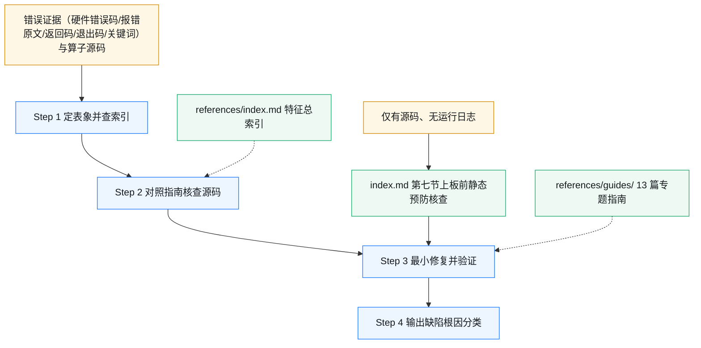

# Ascend C AI Core 异常调试 Skill

`tool-aicore-debug` 用于检测与修复昇腾 NPU AI Core 算子异常。按报错证据（十六进制硬件错误码 / 报错原文 / 同步返回码 / 退出码 / 关键词）判定硬件表象分类，再经特征总索引定位 1~2 篇专题修复指南，对照检查清单核查源码并套用标准修复模板，最后输出缺陷根因分类；无运行日志时可对算子源码做上板前静态预防检查。适用于 EZ9999 报错、AI Core Error、kernel 挂起或超时被 kill、UB/L1/L2/GM 越界溢出、Cube/FixPipe/DataCopy/LoadData 配置非法等 Device 侧异常；不适用于纯环境显存不足、C++ 语法报错、纯浮点舍入误差与性能调优。

## 工作流



| 阶段 | 主要工作 |
| --- | --- |
| Step 1 定表象并查索引 | 按 P1→P6 确定表象：全局显存访问异常 / 片上缓存越界 / 指令非法或地址未对齐 / 核函数超时挂死 / 数值异常 / 无硬件报错的静默结果或返回码异常；查索引定位 1~2 篇指南 |
| Step 2 对照指南核查源码 | 先查主控入口，再按 tilingKey 查激活架构核函数；结合输入契约和证据验证候选原因 |
| Step 3 最小修复并验证 | 仅修复任务根据证据做最小修改，先回放原失败用例，再完成项目要求的相关回归 |
| Step 4 输出缺陷根因分类 | 按实际修复层说明根因分类、证据与验证结果；未确认的原因保留为候选，只定位任务不修改正式实现 |

完整流程与四条必守执行纪律见 [SKILL.md](skills/tool-aicore-debug/SKILL.md)。

## 知识与工具

| 能力 | 内容 |
| --- | --- |
| 特征总索引 | `references/index.md`：按 P1~P6 分区组织报错码、边界差异特征与源码特征词，直查专题指南 |
| 专题指南 | 13 篇 `references/guides/*.md`：主控契约（host_\*，4 篇）、访存与搬运（mem_\*，5 篇）、同步与数值（sync_\* 与 numeric，3 篇）、编译与架构（1 篇），含检查公式、常见误区与标准 C++ 修复模板 |
| 回归集 | `evals/evals.json`：触发边界与索引路由回归用例 |
| 证据收集 | 路由线索不足时，按 cannbot-knowledge（`ops/ascendc/guides/diagnostics/`）的工具契约卡执行 msaicerr / asys / msnpureport 采集故障信息 |

## 使用指南

### 安装

安装内容包括 `tool-aicore-debug` 和 `knowledge-query`。默认安装到当前目录 `.`，以下命令可直接复制执行。需要更改安装目录时，将 `.` 改为已有项目的路径，例如 `/path/to/project`。省略目录参数时也使用当前目录。

安装到 Codex：

```bash
curl -fsSL https://raw.gitcode.com/cann/asc-tools/raw/master/skills/tool-aicore-debug/scripts/install.sh | bash -s -- codex .
```

安装到 Claude Code：

```bash
curl -fsSL https://raw.gitcode.com/cann/asc-tools/raw/master/skills/tool-aicore-debug/scripts/install.sh | bash -s -- claude .
```

安装到 OpenCode：

```bash
curl -fsSL https://raw.gitcode.com/cann/asc-tools/raw/master/skills/tool-aicore-debug/scripts/install.sh | bash -s -- opencode .
```

本地已有文件时，在本 README 所在目录执行：

```bash
bash scripts/install.sh codex .
```

### 全局安装

需要在当前用户的所有项目中使用时，显式添加 `--global`。

Codex：

```bash
curl -fsSL https://raw.gitcode.com/cann/asc-tools/raw/master/skills/tool-aicore-debug/scripts/install.sh | bash -s -- codex --global
```

Claude Code：

```bash
curl -fsSL https://raw.gitcode.com/cann/asc-tools/raw/master/skills/tool-aicore-debug/scripts/install.sh | bash -s -- claude --global
```

OpenCode：

```bash
curl -fsSL https://raw.gitcode.com/cann/asc-tools/raw/master/skills/tool-aicore-debug/scripts/install.sh | bash -s -- opencode --global
```

| 客户端 | 默认全局 Skill 入口 |
| --- | --- |
| [Codex](https://learn.chatgpt.com/docs/build-skills) | `~/.agents/skills/` |
| [Claude Code](https://code.claude.com/docs/en/skills) | `~/.claude/skills/` |
| [OpenCode](https://opencode.ai/docs/skills/) | `~/.config/opencode/skills/` |

已有 `CLAUDE_CONFIG_DIR`、`OPENCODE_CONFIG_DIR` 或 `XDG_CONFIG_HOME` 设置时，安装器使用对应配置目录。在线下载时，全局安装的 Skill 实体位于 `~/.asc-tools/tool-aicore-debug/`，知识库默认位于 `~/.cannbot/cannbot-knowledge/`，只为所选客户端建立入口。

### 安装选项与检查

| 常用选项 | 用途 |
| --- | --- |
| `--global` | 为当前用户全局安装，与项目目录参数互斥 |
| `--python` | 后接 Python 可执行文件，指定安装时使用的环境 |
| `--knowledge-root` | 后接已有完整知识库的目录，直接复用 |
| `--without-knowledge` | 仅安装调试 Skill，不准备知识库 |
| `--offline` | 使用已准备好的本地文件和依赖安装 |
| `--update` | 更新通过在线安装获取的内容 |

这些选项同样支持 curl 安装命令。更多选项见 `bash scripts/install.sh --help`。

在线下载时，项目安装将调试 Skill 放在 `.asc-tools/tool-aicore-debug/`，其中直接包含 `SKILL.md`、`references/` 和 `evals/`；选择安装知识库时，知识仓下载到 `.cannbot/cannbot-knowledge/`，知识配置保存在 `.cannbot/knowledge.env`（复用当前安装根目录中已有的知识配置；需要共享 precision-debug 默认的全局知识仓时，显式传入 `--knowledge-root ~/.cannbot/cannbot-knowledge`）。Codex 和 OpenCode 共用 `.agents/skills/` 入口；Claude Code 另建 `.claude/skills/` 链接。

安装或更新后，在目标项目中重新打开客户端，确认可以使用 `tool-aicore-debug`。需要确认知识查询是否可用时，可以让 Agent 执行：

```text
使用 knowledge-query，检索 ops/ascendc/guides/diagnostics/ 下与 AI Core Error 证据收集相关的知识卡。
```

本地运行安装脚本时，自动复用相邻的 `skills/tool-aicore-debug/`；也可用 `--package-root` 指定纯技能目录。此时入口直接链接到该目录，不复制到 `.asc-tools/`，`--update` 不更新本地技能源码。请保留源目录；移动或删除它会使链接失效。显式 `--knowledge-root` 同样只复用指定仓库，不自动拉取更新，但安装时仍会验证依赖与索引，必要时构建索引。

### 触发方式

可以直接点名 Skill，也可以描述需要排查的 AI Core 异常，例如：

```text
使用 tool-aicore-debug，诊断这个 EZ9999 报错。
这个 Ascend C kernel 运行后被 kill，退出码 124 且没有 stderr 输出，请定位原因。
算子上板前，用 tool-aicore-debug 做一次预防性扫描。
```

### 调试前提供什么

- 错误证据：EZ9999 报错原文（含 errcode 字段）、十六进制硬件错误码、同步返回码、进程退出码或关键词，至少其一。
- 算子源码文件或目录；未提供时只输出表象分类与排查方向，不编造行号。
- 仅有源码、无运行日志时，可直接要求做上板前静态预防检查（`references/index.md` 第七节）。

### 使用示例

定位并修复：

```text
使用 tool-aicore-debug 诊断当前 AI Core 异常：
error_str 为 EZ9999（errcode=141），算子源码在 ./op，
给出硬件表象分类、命中的修复指南与标准改法，并说明缺陷根因分类。
```

区分十进制 errcode 与进程退出码：

```text
算子运行时 stderr 报 EZ9999，十进制 errcode=124（进程退出码为 1）。
请用 tool-aicore-debug 区分它与 exit_code=124 的差异，并给出修复文档与对齐公式。
```

上板前预防性检查：

```text
目前还没有上板运行日志，请用 tool-aicore-debug 对 ./op 做上板前静态预防检查。
```

### 结果交付

输出按 P1~P6 确定的硬件表象分类、命中的 1~2 篇专题指南、对照检查清单的核查结论、最小修复方案（含标准 C++ 修复模板与验证顺序）与缺陷根因分类；证据不足时明确列出缺失的证据与待验证方向，不编造行号、不声称已确诊。
