# Ascend 多卡通信调试 Skill

`tool-comm-debug` 用于定位和修复 Ascend 多卡通信与通信融合异常。对于卡住、超时或接口报错，按 rank 查找首个异常和等待点；对于通信完成后的错误结果，沿数据流查找首个偏差。覆盖 HCCL / Hcomm、CPU_TS / AIV、自定义 Ascend C 通信算子、原生 ACLNN / MC2 融合算子和 MoE Dispatch/Combine。

## 工作流与架构图

```mermaid
flowchart TB
    A[症状、源码、日志或失败用例] --> B{本次运行结果}
    B -->|卡住、超时或报错| C[对齐各 rank 的调用、退出状态与等待点]
    B -->|通信完成但结果错误| D[按 rank、轮次和数据段追踪设备输出]
    C --> E[结合源码和现场证据定位根因]
    D --> E
    K[症状卡、方法指南、现场工具和知识查询] -.-> E
    E -->|仅定位| H[交付结论与证据]
    E -->|要求修复| F[修复通信、同步或数据处理逻辑]
    F --> G[重新构建并回放原失败用例]
    G -->|出现偏差| E
    G -->|符合验收约定| H
```



| 阶段 | 主要工作 |
| --- | --- |
| 确认现场 | 确认实际使用的设备、CANN 版本、运行入口、产物目录和验收约定。 |
| 定位首错或首个偏差 | 超时场景区分先出错的 rank 与等待方；数值场景对齐生产方、消费方、偏移和有效长度。 |
| 核实根因 | 用源码和日志核对调用次序、通知配对、缓冲复用或路由关系。按证据缺口选择现场工具。 |
| 修复与回放 | 修改受影响的实现，用原输入重跑，逐 rank、逐轮核对本次运行生成的最终产物。 |
| 交付 | 给出问题位置、触发条件、证据和实际验证结果。仅定位任务可直接交付分析。 |

完整流程见 [SKILL.md](skills/tool-comm-debug/SKILL.md)。

## 知识与工具

`references/` 共收录 27 篇参考文档，可从[症状索引](skills/tool-comm-debug/references/INDEX.md)按现场现象查阅。

| 资源 | 数量 | 内容 |
| --- | ---: | --- |
| 症状卡 | 9 篇 | 通信超时、集合通信参数或通信组不匹配、单 rank 阻塞、流与事件等待、同步失衡、算子异常、通信引擎协议故障和复合异常。 |
| 现场工具卡 | 6 篇 | plog、msprof、msnpureport、hccn_tool、hccl_test 和 msaicerr 的适用场景与取证方法。 |
| 方法指南 | 6 篇 | 日志关键字、rank 定位、诊断决策树、协议与数据流、原生融合链路、AIV 搬运对齐。 |
| 修复指南 | 2 篇 | 修复通用约束，以及按异常类型组织的修复与验证方法。 |
| 入口、边界与知识文档 | 4 篇 | 症状索引、适用范围、相近症状的区分依据和外部知识访问方式。 |

[evals/evals.json](skills/tool-comm-debug/evals/evals.json) 收录 12 条评测用例。Skill 可独立使用，也可配合 `cannbot-knowledge` 的 `knowledge-query` 查询芯片架构与示例，用 `ascendc-api-knowledge-query` 查询 Ascend C API 约束。使用查询结果时核对卡片引用的版本、平台和当前工程的 SDK。详见[知识访问说明](skills/tool-comm-debug/references/knowledge-access.md)。

## 使用指南

### 安装

安装器使用 Bash 和 Python 3.10 或更高版本。在线获取 Skill 或准备知识查询时需要 Git。默认安装 `tool-comm-debug` 和两个知识查询 Skill。在目标项目中按客户端选择一条命令，末尾的 `.` 可替换为已有项目目录。

**Codex**

```bash
curl -fsSL https://raw.gitcode.com/cann/asc-tools/raw/master/skills/tool-comm-debug/scripts/install.sh | bash -s -- codex .
```

**Claude Code**

```bash
curl -fsSL https://raw.gitcode.com/cann/asc-tools/raw/master/skills/tool-comm-debug/scripts/install.sh | bash -s -- claude .
```

**OpenCode**

```bash
curl -fsSL https://raw.gitcode.com/cann/asc-tools/raw/master/skills/tool-comm-debug/scripts/install.sh | bash -s -- opencode .
```

本地已有仓库时，在本 README 所在目录执行以下命令。安装入口直接链接到仓库中的纯 Skill 目录，移动仓库后需重新配置入口。

```bash
bash scripts/install.sh codex .
```

### 全局安装

在当前用户的所有项目中使用时，省略项目目录并添加 `--global`。按客户端选择一条命令。

```bash
curl -fsSL https://raw.gitcode.com/cann/asc-tools/raw/master/skills/tool-comm-debug/scripts/install.sh | bash -s -- codex --global
curl -fsSL https://raw.gitcode.com/cann/asc-tools/raw/master/skills/tool-comm-debug/scripts/install.sh | bash -s -- claude --global
curl -fsSL https://raw.gitcode.com/cann/asc-tools/raw/master/skills/tool-comm-debug/scripts/install.sh | bash -s -- opencode --global
```

| 客户端 | 默认全局入口 | 配置目录 |
| --- | --- | --- |
| Codex | `~/.agents/skills/` | 当前用户的 `.agents` 目录。 |
| Claude Code | `~/.claude/skills/` | 设置 `CLAUDE_CONFIG_DIR` 后使用其 `skills/` 子目录。 |
| OpenCode | `~/.config/opencode/skills/` | 优先使用 `OPENCODE_CONFIG_DIR/skills/`，其次使用 `XDG_CONFIG_HOME/opencode/skills/`。 |

全局安装只为所选客户端建立入口。在线获取的 Skill 位于 `~/.asc-tools/tool-comm-debug/`，知识库默认位于 `~/.cannbot/cannbot-knowledge/`。目标平台可在查询时指定。

### 安装选项与检查

| 选项 | 用途 |
| --- | --- |
| `--global` | 为当前用户安装，与项目目录参数互斥。 |
| `--python PATH` | 选择安装和知识查询检查使用的 Python，默认取 `CANNBOT_PYTHON` 或 `python3`。 |
| `--knowledge-root PATH` | 复用已有的完整 `cannbot-knowledge` 仓库。 |
| `--platform ID` | 设置项目查询的默认平台，ID 取自知识库 `governance/schemas/registries.yaml` 的 `platforms`。 |
| `--without-knowledge` | 只安装通信调试 Skill。 |
| `--with-sources docs\|code\|all` | 调用知识库的 `get_resources.sh` 获取文档、算子源码或两者。 |
| `--offline` | 使用本地 Skill、知识库和现有 Python 依赖，支持在本地构建查询索引。 |
| `--update` | 更新在线获取的 Skill 和托管知识库。 |

在线项目安装将纯 Skill 放在 `.asc-tools/tool-comm-debug/`。Codex 和 OpenCode 共用 `.agents/skills/`，Claude Code 另建 `.claude/skills/` 链接。OpenCode 项目重装会清理 `.opencode/skills/` 中指向同一安装目标的旧链接。知识库默认位于 `.cannbot/cannbot-knowledge/`，`.cannbot/knowledge.env` 记录解析后的知识库绝对路径。已有配置也可复用 `.cannbot/precision-debug/cannbot-knowledge/`。

项目安装后可检查入口，再重新打开客户端。安装知识查询时，安装器会校验索引、按需构建并执行一次 `discover` 查询。

```bash
ls -l .agents/skills/tool-comm-debug
```

本地执行 `bash scripts/install.sh --help` 可查看完整选项，包括 `--package-root`、仓库地址、分支和纯 Skill 的相对路径。

### 触发方式

可直接点名 `tool-comm-debug`，也可描述通信异常。例如：“四卡作业中 rank 2 先退出，另外三个 rank 随后报 HCCL 超时，请定位首个失败点。”

### 调试前提供什么

- 已有的症状、首条错误或相关源码。提供日志时，保留对应的 rank、时间和进程退出码。
- 实际设备型号、CANN 版本、参与通信的 rank 与设备映射，以及构建和运行入口。
- 数据错误场景中的失败轮次、shape、dtype、预期值和本次设备输出。已有比较器时提供调用方式。
- 本次任务目标、允许读取或修改的目录，以及设备回放和报告输出要求。

### 使用示例

**定位超时**

```text
使用 tool-comm-debug 分析本次双卡任务。rank 0 的 plog 显示通信超时，rank 1 有一条更早的接口错误。
请按调用次序对齐两边的日志，说明首错 rank、等待方和对应代码位置。本次只做定位。
```

**修复跨轮数据偏差**

```text
这个 AIV 通信算子首轮输出正确，第二轮 rank 1 收到的尾段沿用了首轮的值。
请从尾段的来源、搬运范围、通知配对和缓冲复用时机排查，在算子目录内修复。
用原输入回放两轮，按现有比较器检查两个 rank 的完整设备输出。
```

**排查 MoE 路由合并**

```text
MC2 MoE Dispatch/Combine 调用正常返回，但部分 token 合并后落到了错误的位置。
请核对各 rank 的路由元数据、分段偏移和回收顺序，指出数据首次偏离预期的位置与依据。
```

### 结果交付

诊断报告包含异常类型、异常 rank、等待点或数据错误点、根因、证据链、修复方案和对照结果。结论关联到具体文件、代码行、日志或设备产物；证据不足时列出候选原因和区分它们所需的最小检查。

修复任务还交付实际修改位置、构建和运行结果，以及按验收约定核对的 rank、轮次和输出范围。需要保存报告时，在任务中指定输出路径。
