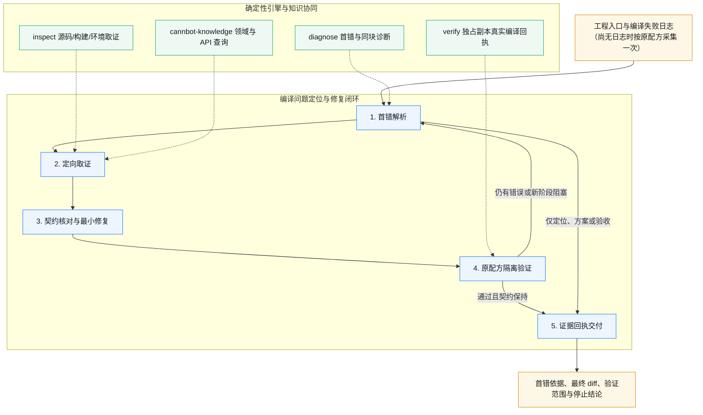

# Ascend C 编译问题定位与修复 Skill

`tool-compile-debug` 用于定位与修复 Ascend C / CANN 算子及工程（含单算子、自定义算子仓、CATLASS、HCCL 等 C++/CMake/`build.sh` 工程）的编译与构建失败，引导 Agent 从解析首错、按需取证、核对领域与 SDK 声明，到输出定位结论或实施保契约修复并完成原配方构建验证。覆盖 CMake 配置、头文件/库依赖、Host/Kernel 域错配、模板与 API 签名、Tiling 结构体一致性、版本/SoC 门控、链接及打包错误，适用于 Linux、CANN ≥ 9.0.0（覆盖 9.0 / 9.1 / 9.2 与 Ascend 910 / 950 目标）。

## 工作流与架构图



| 阶段 | 主要工作 |
| --- | --- |
| 首错解析 | 用确定性引擎解析已有构建失败日志（尚无日志时锁定最小原配方采集一次），提取首错位置、失败阶段与编译器同块提示 |
| 定向取证 | 按需读取失败编译单元、声明依赖、构建记录与 SDK 环境；存在平台/API 歧义时调用知识查询技能核实 |
| 契约核对与最小修复 | 保留用户的接口、dtype、shape、布局与目标架构，基于当前配置的有效证据做最小修改，拒绝删功能或盲目强转 |
| 原配方隔离验证 | 在工程外独占副本按原目标配方执行真实编译验证，核对旧失败覆盖、目标架构与标识符契约检查 |
| 证据回执交付 | 汇总首错依据、最终 diff、SDK/SKU/目标、验证回执状态及是否存在未决补丁风险 |

仅请求编译问题定位、修复方案或补丁验收评审时，按证据给出根因位置、下一步与验收判据，不执行构建或修改代码。完整流程见 [SKILL.md](skills/tool-compile-debug/SKILL.md)。

## 知识与工具

| 能力 | 内容 |
| --- | --- |
| 确定性日志首诊（`diagnose`） | 轻量解析长构建日志，输出 `primary_error`、`failure_stage`、`diagnostic_facts` 与条件性取证指引，不预载全工程源码 |
| 按需上下文取证（`inspect`） | 受控预算读取失败源码与头文件闭包、展开 `@response` 构建命令、核查激活 SDK 版本及工作区卫生 |
| 原配方构建验证（`verify`） | 在工程外临时副本复现原 `build.sh` / CMake 配方，生成含目标覆盖与契约保持检查的结构化回执 |
| CANN 知识查询 | 协同 cannbot-knowledge `knowledge-query` 技能查询环境排障、CMake、版本差异、SKU/架构与 Tiling 经验；协同 cannbot-knowledge `ascendc-api-knowledge-query` 技能查询 Ascend C API 声明、头路径、模板约束与支持目标 |
| 分享前脱敏（`redact`） | 对外分享诊断报告或日志前，按需脱敏本机路径、IP、邮箱与自定义敏感词 |

## 使用指南

### 安装

安装内容包括纯净版 `tool-compile-debug`（含 `SKILL.md`、`references/`、`evals/` 与 `scripts/` 确定性运行引擎，不含本 `README.md`、`install.sh` 与随仓 `tests/`）以及 cannbot-knowledge `knowledge-query` 技能与 cannbot-knowledge `ascendc-api-knowledge-query` 技能。

- **交互式引导安装（推荐）**：直接运行下方命令，脚本会在终端依次引导你选择**目标客户端**（`codex`、`gemini`、`opencode`、`claude`）与**安装位置**（当前项目 / 全局 / 自定义目录），默认使用全局共享的 `~/.cannbot/cannbot-knowledge` 并在确认摘要中明确提示：

```bash
curl -fsSL https://raw.gitcode.com/cann/asc-tools/raw/master/skills/tool-compile-debug/scripts/install.sh | bash
```

- **非交互直装（通过参数跳过提示）**：`codex`、`gemini`、`opencode` 共用 `.agents/skills/`；`claude` 单独使用 `.claude/skills/`，与前者同选时自动建立软链共享：

```bash
# 默认装入当前项目 ./.agents/skills/（跳过提示）
curl -fsSL https://raw.gitcode.com/cann/asc-tools/raw/master/skills/tool-compile-debug/scripts/install.sh | bash -s -- --yes

# 仅安装到 Claude Code（直装 ./.claude/skills/，不建 .agents/skills/）
curl -fsSL https://raw.gitcode.com/cann/asc-tools/raw/master/skills/tool-compile-debug/scripts/install.sh | bash -s -- --clients claude

# 同时适配全部 4 个客户端（codex / gemini / opencode / claude）
curl -fsSL https://raw.gitcode.com/cann/asc-tools/raw/master/skills/tool-compile-debug/scripts/install.sh | bash -s -- --clients all
```

- **安装到其他项目目录或自定义目录**：

```bash
# 指定目标项目目录
curl -fsSL https://raw.gitcode.com/cann/asc-tools/raw/master/skills/tool-compile-debug/scripts/install.sh | bash -s -- --project /path/to/project

# 安装到自定义目录
curl -fsSL https://raw.gitcode.com/cann/asc-tools/raw/master/skills/tool-compile-debug/scripts/install.sh | bash -s -- --target /path/to/my-skills
```

本地已有仓库检出时，在本 README 所在目录执行：

```bash
bash scripts/install.sh
```

### 全局安装

需要在当前用户的所有项目中使用时，添加 `--global`：

```bash
# 全局安装到 ~/.agents/skills/（支持 Codex、Gemini CLI、OpenCode）
curl -fsSL https://raw.gitcode.com/cann/asc-tools/raw/master/skills/tool-compile-debug/scripts/install.sh | bash -s -- --global

# 全局安装并同时适配 Claude Code（~/.agents/skills/ + ~/.claude/skills/ 软链）
curl -fsSL https://raw.gitcode.com/cann/asc-tools/raw/master/skills/tool-compile-debug/scripts/install.sh | bash -s -- --global --clients all

# 仅全局安装到 Claude Code（~/.claude/skills/）
curl -fsSL https://raw.gitcode.com/cann/asc-tools/raw/master/skills/tool-compile-debug/scripts/install.sh | bash -s -- --global --clients claude
```

| 客户端 | 项目级目录 | 全局目录 |
| --- | --- | --- |
| Codex / Gemini CLI / OpenCode | `./.agents/skills/` | `~/.agents/skills/` |
| Claude Code | `./.claude/skills/` | `~/.claude/skills/`（支持 `CLAUDE_CONFIG_DIR`） |

### 安装选项与检查

| 常用选项 | 用途 |
| --- | --- |
| `--clients <list\|all>` | 指定目标客户端：`codex,gemini,opencode,claude` 或 `all`（默认 `codex,gemini,opencode`） |
| `--project <dir>` | 指定项目目录（默认当前目录） |
| `--global` | 为当前用户全局安装，与 `--project`、`--target` 互斥 |
| `--target <dir>` | 直接安装到自定义目录 |
| `--python <bin>` | 指定 Python >= 3.10 解释器（默认自动探测或读取 `CANNBOT_PYTHON`） |
| `--knowledge-root <dir>` | 复用已有本地完整 `cannbot-knowledge` 仓库（默认 `~/.cannbot/cannbot-knowledge`） |
| `--pinned` | 使用内置锁定 commit 准备独立可复现知识仓（适用于固定基线评测） |
| `--read-only-knowledge` | 只读复用已建好索引的知识仓，禁止修改仓库、安装依赖或写入索引 |
| `--without-knowledge` | 仅安装 `tool-compile-debug`，不准备知识库与查询 Skill |
| `--offline` | 离线模式：仅复用已有本地文件与 Python 依赖，不联网更新 |
| `--force` | 覆盖目标目录中已存在但非本安装器管理的同名目录或本地改动副本 |
| `-y, --yes` | 非交互模式：直接按默认值安装，不弹出选择提示 |

这些选项同样支持 `curl ... | bash -s --` 命令。完整参数见 `bash scripts/install.sh --help`。

> **关于更新与 `cannbot-knowledge` 共享目录**：
> - **安装与更新使用同一条命令**：后续 `tool-compile-debug` 或 `cannbot-knowledge` 有新版本时，直接重跑安装命令（不加 `--offline`）即可自动拉取最新 Skill、fast-forward 更新共享知识仓，并在卡片变化时自动重建检索索引（耗时步骤自带动态进度与计时提示）。
> - 知识仓默认存放于全局共享目录 **`~/.cannbot/cannbot-knowledge`**，多项目通过软链共用同一份知识库与索引；任一项目触发更新后，本机所有项目共享的知识库同步生效。如需按项目隔离、使用 `--pinned` 固定版本或复用本地已有知识仓，可通过对应参数指定。

安装或更新后，在目标项目中重新打开客户端，确认可以使用 `tool-compile-debug`。需要自检随包确定性引擎或确认知识查询是否可用时，可执行包内 `face_selfcheck.py` 或让 Agent 执行：

```text
使用 ascendc-api-knowledge-query，查询当前目标平台上 DataCopyPad 的头文件声明与模板参数约束，并给出依据。
```

### 触发方式

可以直接点名 Skill，也可以直接给出编译失败现象或构建日志，例如：

```text
当前 Ascend C 算子工程编译出错了，请帮我定位并修复。
使用 tool-compile-debug，分析这份 build.log 的编译报错并保留原接口修复。
这个 CATLASS 样例在 Ascend950 下编译模板匹配失败，请给出修复方案（暂不修改代码）。
```

### 排查前提供什么

- **待排查工程与构建入口**：工程目录，以及原有的 `build.sh` 或 CMake 目标配方。
- **编译失败日志**：已有的完整编译失败日志路径；若尚无日志且当前环境可执行构建，Agent 会先按最小原配方采集一次。
- **目标芯片 SKU**：如 `Ascend910B1`、`Ascend950`（若暂不确定，可由已有构建脚本或失败日志协助确认）。
- **CANN SDK 环境（按任务类型区分是否必需，及提供方式）**：
  - **是否必需**：**仅基于已有日志做问题定位、输出修复方案或评审补丁时不是必需的**，只需告知已知的 CANN 版本号（未知时亦可从日志提取线索，未执行重编的部分会明确标注“待编译验证”）；**需要首次采集失败日志或执行真实编译验证（`verify`）时必需**在实际构建的 Linux 环境（本机、容器或远端会话）具备可用的 CANN 工具链与 CMake（本技能支持基线为 CANN ≥ 9.0.0；未探测到 SDK 时 `verify` 返回 `cann_not_found`，其它工具链缺失按实际原因报告，均不会误报编译通过）。
  - **怎么提供**：① **启动客户端前激活（推荐）**：在启动 Agent 客户端的**同一终端会话**先执行 `source /usr/local/Ascend/ascend-toolkit/set_env.sh`（或实际安装目录下的 `set_env.sh`），使当前进程及后续 `verify` / 构建子进程直接继承该脚本设置的环境变量与 `PATH`（在其它独立终端窗口 `source` 不会对当前会话生效）；② **在对话中告知环境脚本路径**：若启动前未激活，直接告知本机 SDK 安装目录及对应 `set_env.sh` 路径（或容器/远端构建入口），由 Agent 在启动 `verify` 或构建命令的同一子 Shell 中先加载对应环境再执行验证（注意若仅 `build.sh` 内部私自指向非标准 SDK 路径而外层未加载，需一并告知以便 `verify` 前置环境探测识别）。
- **契约约束与本次目标**：需要保持不变的算子接口、dtype、shape、数据布局或实现路线约束，以及本次目标是**定位并完成编译修复**，还是**仅定位原因 / 输出修复方案 / 评审已有补丁收据**。

### 使用示例

定位并完成原配方编译修复：

```text
使用 tool-compile-debug 定位并修复当前工程的编译失败。
已有日志在 /tmp/build_fail.log，目标芯片为 Ascend910B1（当前终端已 source CANN set_env.sh）。
请保持现有算子原型与 Tiling 数据契约不变，修改后按原构建入口完成验证并给出回执摘要。
```

仅定位问题或输出编译修复方案（无需激活 SDK、只读不改代码）：

```text
请根据当前工程和 build.log 定位编译报错原因并给出修复方案，不要执行构建或修改任何源码。
目标环境为 CANN 9.0.0 / Ascend910B1，请说明首错位置、待核实的声明依据以及后续原配方验收命令。
```

评审已有补丁与构建记录：

```text
请检查当前 git diff 和 verify.json 收据是否真正修复了原编译故障，
核对原失败单元覆盖、目标架构一致性以及是否存在删减功能的契约风险。
```

### 结果交付

根据任务要求，Agent 会交付首错位置与诊断依据、最终保留契约的源码或构建配置修改、原配方及 SDK/SKU/目标信息、真实构建验证日志及通过/未确认范围说明；无需额外运行时会明确给出停止结论，存在未决补丁风险则会指出需补充的针对性验证。
