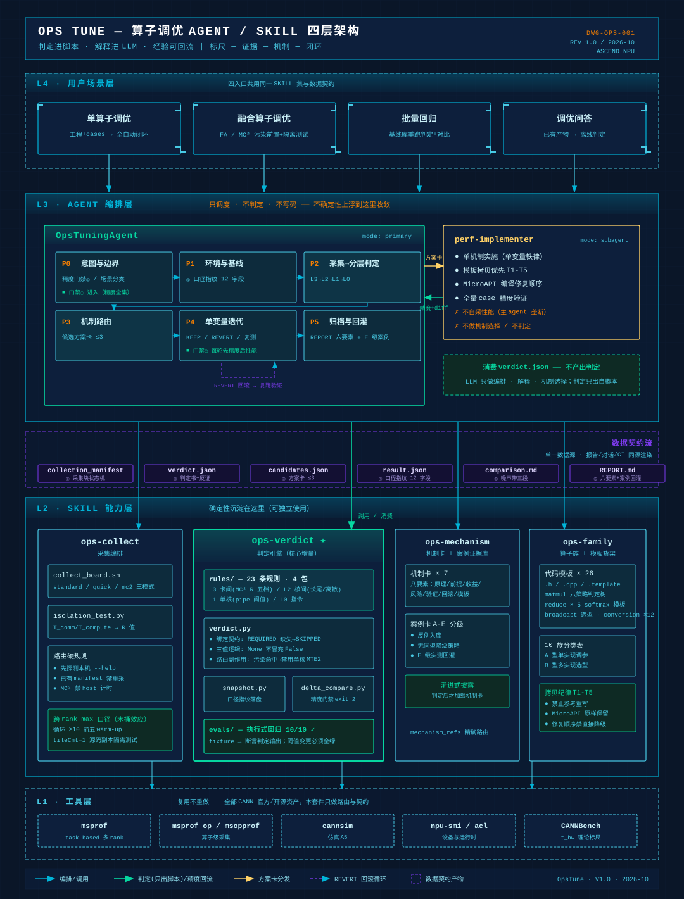

# 算子调优 AGENT/SKILL 规划文档（OpsTune）

> OpsTune · 昇腾算子性能调优 Agent + SKILL 套件
> 版本 V1.2 ｜ 2026-10 ｜ 开源版（基于项目立项规划 V1.1 适配：聚焦场景/架构/演进主线，仓库链接统一指向本仓）
> V1.1 增补：外部知识动态引用（D9）｜ 五级路由（D10）｜ 知识构成与扩展（K1-K5）
> 配套文档：[算子调优AGENT设计文档.md](算子调优AGENT设计文档.md)（架构与契约）

---

## 目录

1. **用户场景与价值**——调优为什么是刚需、现状七大痛点
2. **全景与流量入口**——Agent/SKILL 全景图、CLI 与 Toolkit 双入口
3. **竞争力支柱**——四大竞争力支柱、生态协作
4. **完整方案与落地**——四层架构、判定引擎详设、演进里程碑

---

# 第一部分：用户场景与价值

## 1. 用户场景：调优是算子交付的最后一公里

**核心判断：算子性能每差一倍，模型训练成本就多烧一倍。**

四类真实高频场景：

| 场景 | 输入特征 | 关键差异 | 定位 |
|------|---------|---------|------|
| **单算子调优** | 可运行、精度通过的工程 + cases | 全五阶段流程，逐 case 全量覆盖 | 最高频场景 |
| **融合算子调优** | FA / MC² 类（fork 多 rank / CrossCore 绑核） | 污染前置检查 + L3 全启用 + 隔离测试编排 | 价值最高、最难 |
| **批量回归** | 基线库已有历史 | Phase 1 简化（基线直取）+ 回归门禁语义 | 交付质量保障 |
| **调优问答** | 已有 profiling 产物 | 仅 Phase 2 离线判定 + 报告解读 | 知识服务 |

两类用户：

- **一线算子工程师**（多数）：需要「给工程就出判定书与优化清单」——不懂 PMU 指标也能完成调优闭环，把性能达标变成日常交付动作。
- **性能专家**：专家诊断吞吐受人头限制（一次 MTE2 Bound / VF 级别诊断常以人月计）；需要把经验规模化复用，把时间集中到最难的融合算子。

**痛点锚点：一次 MTE2 Bound / VF 级别的专家诊断 ≈ 1 人月——这就是本项目要压缩的数字。**

## 2. 现状七大痛点（三个是结构性的）

| # | 痛点 | 现状根因 | 代价 |
|---|------|---------|------|
| 1 | **专家依赖** 🔴 | MTE2 Bound / VF 诊断需资深专家约 1 人月/次；指标是原始 PMU 数值，无判定规则引擎 | 调优吞吐受人头限制，经验难传承 |
| 2 | 无理论标尺 | 不知道离硬件极限还差多少；无常驻「达上限百分比」读数 | 值不值得做无判据 |
| 3 | 无基线记忆 | 输出是一次性 CSV，无版本化基线、无跨 run diff | 回归问题集成阶段才暴露 |
| 4 | 数据链路割裂 | 时间线/指标/源码独立产物，关联键只在解析层 | 定位靠人工跨文件比对 |
| 5 | 采集门槛高 | 多卡/融合算子采集暴露为多步手工命令行 | 关键指标「能采但采不到」 |
| 6 | **融合算子盲区** 🔴 | FA/MC² 无体系化诊断路径；跨核/跨卡瓶颈相互污染 | 只能凭通用原理推导 |
| 7 | **经验不回流** 🔴 | 阈值/收益散在文档，无 schema 无芯片域标注 | 知识资产持续流失 |

**判断：痛点不是工具缺失而是体系缺失。** 业界共性短板 = 判定引擎缺位、执行式评测缺位、知识无契约、经验不回流——正是本项目四个主攻方向。

## 3. 用户价值：三个可度量的数字

| KPI | 目标 | 含义 |
|-----|------|------|
| **TTFI ≤ 10 min** | 框架期出口目标 | 交付样本到首个「判定+动作」结论的耗时（对标当前专家约 1 人月/次） |
| **预估-实测偏差 ≤ 30%** | 自进化期目标 | 校准闭环让收益预估可信 |
| **案例季增 ≥ 20** | 自进化期目标 | 经验从个人大脑变成可检索资产 |

价值分层：

- **大部分简单算子**（VECTOR / 单范式 MatMul）：下载 SKILL 直接生成性能达标，全自动闭环。
- **复杂融合算子**（FA / MC²）：AI 判定 + 专家会诊，把专家时间集中到最难的 20%。

价值公式：**调优吞吐 = 工具链自动化 × 知识复用率 × 判定可信度**——三者分别由 Agent 编排、SKILL 知识库、规则引擎承载。

---

# 第二部分：全景与流量入口

## 4. Agent/SKILL 全景图：四层架构



> 高清图件：[SVG](figures/opstune-architecture.svg) ｜ [PNG](figures/opstune-architecture.png)

四层职责速读：

- **L4 用户场景层**——单算子 ｜ 融合算子（FA/MC²）｜ 批量回归 ｜ 调优问答，四入口共用同一 SKILL 集与数据契约
- **L3 Agent 编排层**——OpsTuningAgent 五阶段主循环（P0~P5）+ perf-implementer subagent；只编排不判定：消费 verdict.json，不做 Bound 判定
- **L2 SKILL 能力层**——ops-collect 采集编排 ｜ ops-verdict 判定引擎 ★ ｜ ops-mechanism 机制与案例 ｜ ops-family 算子族与模板货架（确定性沉淀在这里，可独立使用）
- **L1 工具层**——msprof（task-based 多 rank）· msprof op / msopprof · cannsim · CANNBench（t_hw 标尺）· npu-smi / acl——复用不重做，全部 CANN 官方/开源资产

**数据流主线**：工程+cases → collection_manifest → verdict.json → 机制卡路由 → 方案卡（≤3）→ implementer 实施 → snapshot → delta_compare → REPORT.md + 回灌条目

**五级路由主线（D10）**：场景（单算子/融合/回归/问答）→ 采集模式（MC² task-based 强制/单卡 standard/无卡 cannsim）→ 判定层（L3 卡间→L2 核间→L1 单核→L0 指令，路由副作用）→ 机制（mechanism_refs 精确路由）→ 算子族（模板货架）。每级路由的决策依据都是结构化产物（场景表/决策树/YAML/契约字段）——**路由进表格，不进 LLM 记忆**。

## 5. 方法论：标尺—证据—机制—闭环

一句话方法论：**算子调优 = 在「算子语义不变」约束下，以标尺—证据—机制—闭环四位一体驱动的分层归因与单变量迭代。**

| 阶段 | 回答的问题 | 手段 |
|------|-----------|------|
| **标尺** | 还差多远 | 理论上限 t_hw / 多维 roofline + 基线锚点 + 跨 rank max 口径 |
| **证据** | 瓶颈是什么 | 八类数据集 + 分层判定（含反证与置信度） |
| **机制** | 怎么改 | 机制卡八要素（收益预估/风险/回滚条件）+ 模板货架 |
| **闭环** | 改好没 | 同口径对比 + ±5% 噪声带三段结论 + 精度门禁 + 经验回灌 |

## 6. 流量入口一：CLI（开发者自助）

```
用户算子工程 + cases.csv
   → Claude / Codex / Opencode 等 CLI Agent
   → 安装算子调优 SKILL 套件（开放标准，即装即用）
   → Agent 五阶段自动调优
   → verdict.json 判定书 + REPORT.md + 优化代码
```

- **开放标准分发**：SKILL 即装即用，无平台依赖；最坏情况 CLI 形态兜底交付。
- **自动闭环**：判定/机制/实施/对比全链路自动，人只在 REPORT 上做决策。
- **独立可用**：四个 SKILL 可脱离 Agent 单独使用（判定引擎 CLI 直跑）。
- **适用边界**：大部分简单算子（VECTOR/elementwise/matmul 单范式）可直接性能达标。

## 7. 流量入口二：AscendC Toolkit + CANNWork Agent（开箱即用）

- **AscendC Toolkit（可视化插件）**：算子性能查看、profiling 可视化、与 CANNWork Agent 集成。
- **CANNWork Agent**：内置调优 SKILL，开箱即用，无需安装配置。
- **闭环能力**：采集（msprof 路由）→ 可视化（性能瀑布/流水图）→ 分析（判定引擎 verdict）→ 优化（机制路由+实施）→ 再采集验证。

**两入口分工**：

| 入口 | 服务对象 | 调优形态 |
|------|---------|---------|
| CLI | 长尾开发者自助调优 | 全自动 |
| Toolkit + CANNWork | 企业级交付、复杂融合算子（FA/MC²） | 人工 + AI 协同 |

**关键设计：两入口共用同一 SKILL 集**——消费同一套规则/机制卡/模板/契约（P4 原则「同一 SKILL 服务多入口」），不重复建设。

---

# 第三部分：竞争力支柱

## 8. 四大竞争力支柱

**对标锚点：NCU 的 Guided Analysis 不是 AI**——它是数据驱动的确定性规则引擎（24 条 Python 规则），Copilot 只做解释。「判定进脚本、解释进 LLM」与 NCU 完全同构，这是可对标可复制的部分；**MC² 通算流水图是 NCU 没有的等价物**（NV 靠 Nsight Systems 补位），应放大而非补齐。

### 竞争力①：性能数据 AI 亲和性设计

| 设计项 | 内容 | 为什么 AI 亲和 |
|--------|------|--------------|
| **DBSqlite 格式** | 采集产物结构化入库（collection_manifest 契约） | Agent/报告/CI 从同一数据源渲染，不存在第二套数字 |
| **指标分层分级** | REQUIRED/OPTIONAL 两级绑定 | 缺失→SKIPPED 不误报；机制上杜绝「指标没采却报瓶颈」 |
| **提取聚合** | 三代列名兼容（aic_/aiv_/ai_）+ ratio_to_pct 双口径归一 + mean/max 双统计 | 判定用 mean 防单核峰值误导 |
| **确定性诊断规则下放** | 阈值判定从文档下沉为 YAML 规则 + 脚本求值 | 阈值带溯源标注，变更必须过 evals 回归 |

### 竞争力②：TOP-DOWN 算子调优顶层设计（分层瀑布）

判定顺序 **L3 卡间 → L2 核间 → L1 单核 → L0 指令**，上层结论作下层输入：

| 层 | 规则数 | 覆盖 |
|----|-------|------|
| L3 卡间 | 7 | MC² R 值五档（T_compute/T_comm）、MTE2 污染路由、跨 rank 不均衡 |
| L2 核间 | 6 | 核间长尾（max>mean×1.25）、离散度三档、切核不足、头开销、host 下发阻塞 |
| L1 单核 | 8 | MTE2/CUBE/VEC/MTE3/FIXP/SCALAR BOUND、LATENCY/SYNC 可疑、串行无重叠指纹 |
| L0 指令 | 3 | ICache miss、L2 hit、stall 主因 |

**路由副作用（融合算子瓶颈污染的架构解）**：L3_MTE2_POLLUTED 命中（full−pure>10pp 或 pure/full<80%）→ **自动禁用 L1_MTE2_BOUND** → 单核访存机制不出现在候选——MC² 场景「单核优化做了白做」的机制化防护。

配套语义：条件三值逻辑（True/False/None），None=证据不足 → INSUFFICIENT_DATA，绝不冒充「无 bound」。

**路由不止判定层（D10 五级路由）**：分层判定只是五级路由中的 R3。从用户输入到模板落地，整条链路都是路由——每级的决策载体都是结构化产物（场景表/决策树/规则 YAML/契约字段/族分类表），LLM 只查表执行不发明路由：

| 级 | 路由轴 | 决策载体 | 错路由的后果 |
|----|--------|---------|-------------|
| R1 | 调优场景（单算子/融合/回归/问答） | Agent 场景表 | MC² 走单算子流程 → 污染未检 → 单核误判 |
| R2 | 采集模式（mc2/standard/cannsim） | tool-routing 决策树 | fork 程序走 msprof op → 数据不可靠 |
| R3 | 判定层次（L3→L2→L1→L0） | 规则包 YAML（layer/priority/soc） | 层序颠倒 → 路由副作用失效 |
| R4 | 优化机制（机制卡路由） | findings[].mechanism_refs | 证据先行被破坏 |
| R5 | 算子族（模板货架） | 族分类表 + 模板链路 | broadcast 三实现选错直接慢/nan |

### 竞争力③：Agent/SKILL 自我进化 + 外部知识动态引用

**知识更新双通道（D9）——应对芯片演进与 AscendC API 演进**：Agent/SKILL 自身的事实性知识（芯片参数、API 签名、官方示例、理论标尺）**不自维护、不落副本**，一律引用 CANN 生态真源（devkit 文档/样例、cann-bench metadata、官方算子仓）动态更新——本仓只存引用清单 + 版本锁定，能运行时探测的（`GetCurNpuArch()`/`GetCoreNumA*`/本机 `--help`）一律探测优先。芯片换代/API 升级的成本被外部真源吸收，本仓演进面收敛在适配层（列名兼容/soc 映射），不在知识正文；引用失效由 CI 可达性校验兜底，而不是判定悄悄出错。

四条回流回路 + 四条防污染纪律：

| 回路 | 内容 | 门禁 |
|------|------|------|
| 案例回流 | REPORT → case_candidate → cases/（脱敏/E 级分级/查重/口径绑定） | 入库评审 |
| 校准闭环 | speedup_est vs 实测 → 逐机制卡回写收益区间 | 偏差看板跟踪 |
| 阈值进化 | 命中率/误报率统计 → 阈值调整建议 | **人审 + evals 全绿才生效** |
| 缺口感知 | 「暂未收录」计数 + 场景矩阵空白格 → 按数据排产 | 周更看板 |

防污染四纪律：进化只产生建议不直接生效 ｜ 证据分级不可逆（E 级不覆盖官方 A 级）｜ 数据脱敏 ｜ 基线库版本化。

### 竞争力④：真实 benchmark 集合（分层用例体系 U0-U3）

- **U0 离线冒烟/单元**：msprof shim + 规则加载校验 + 契约互锁，无卡秒级——确定性 bug（崩溃/死规则/区间重叠）合入即拦截。
- **U1 执行式 evals**：fixture（已知答案 CSV/标量）断言 verdict 输出，**全绿才可合入**（CI 阻断语义）。
- **U2 端到端**：五阶段全链六维断言（精度零劣化/判定正确/加速比/报告六要素/口径纪律/路由）；干跑无卡入 PR 门禁 + 真机每日；CANNBench L1-L4 取材 + 种子工程反向构造。
- **U3 场景矩阵**：算子类型 × 卡规模 × 采集模式 × soc × 场景，覆盖 ≥80%。
- **CICD 触发矩阵**：变更路径 → 用例层级 → 阻断性（rules 变更跑 U0+U1 全量；agent 变更跑 U2 干跑；发版跑全矩阵）——跑用例不靠自觉，靠 diff 驱动。
- **CANNBench 标尺**：t_hw_us 硬件理论下界 + baseline metadata + HAP 评分。
- **真实案例来源**：真机调优实战沉淀（阈值标定与机制卡内容来源）、官方算子仓 PR（A/B 级证据）、本工作流 E 级回灌（可信度等同 A 级机制部分）。

> 用例体系详设（断言分级 M/A/P、统一退出码、CANNBench 口径适配）见《算子调优AGENT用例构建.md》（随测试框架 PR 交付）。

## 9. 生态协作：贡献按需合入，路由策略受控吸收

- **协作范围**：基于 SKILL 自进化技术，提升 **VECTOR / CUBE / MIX（融合）/ FA** 四类算子调优能力——自进化四回路在真实算子上的实证放大。
- **双仓关系**：协作项目仓（自进化技术试验田，快速迭代）↔ 主仓（规则引擎 + 契约 + 评测门禁，稳定底盘）。

**路由策略三原则**：

1. **契约先行**——合入物必须符合已冻结 schema（rule-schema / 机制卡八要素 / 案例卡 schema），不符合不合入；
2. **按需吸收**——按主仓知识缺口（缺口感知数据）择优合入，不整仓同步；
3. **门禁不豁免**——外部贡献与自产贡献走同一 evals 回归 + 人审流程。

## 10. 业界方法论吸收：双向校准不走样

**吸收什么**：① 工具链方法论——NCU Guided Analysis 24 规则的工程形态拆解（绑定契约/DAG/Est.Speedup/持久化，已对标落地 4 项机制）；② 调优实践——跨 DSL（CATLASS/Triton/TileLang/PyPTO）原语对照与机制卡六原语框架；③ 评测体系——业界 benchmark 组织方式与防作弊边界。

**如何落地**：① 契约映射——业界概念映射到本地 schema，映射不上的先观察不合入；② evals 验证——吸收的阈值/规则同样造 fixture 过回归；③ 定期校准——对齐判定质量指标（误报率/偏差），外部见地作为独立视角参与仲裁参考。

---

# 第四部分：完整方案与关键设计（给开发同事）

## 11. 数据契约体系：七个契约文件是全部交付物的数据底座

**单一数据源原则**：REPORT.md（人读）、Agent 概览（对话）、CI 检查（JSON 断言）从同一批契约文件渲染，不存在第二套数字。

| 契约 | schema | 生产者 → 消费者 | 关键字段 |
|------|--------|----------------|---------|
| 采集清单 | opstune.collection/1.0 | collect → verdict/报告 | blocks[]{name,status,path}；已有 manifest 禁重复采集 |
| 判定书 | opstune.verdict/1.0 | verdict → Agent/报告/CI | findings[]{rule_id,severity,confidence,evidence,counter_evidence,speedup_range,mechanism_refs} |
| 结果指纹 | opstune.snapshot/1.0 | snapshot → delta_compare | HARD 12 口径字段 + MECHANISM 2 字段 + precision + status 三态 |
| 对比报告 | comparison.md | delta_compare → REPORT | 三段结论 KEEP/REVERT/复测 + 机制变量 WARN |
| 方案卡 | candidates.json | mechanism → implementer | mechanism/target_rule/evidence/speedup_est/semantic_risk/rollback_if/template |
| 隔离测试 | opstune.isolation/1.0 | isolation_test → verdict --scalar | t_comm_us/t_compute_us/r_value/bound_hint |
| 案例回灌 | case_candidate.json | REPORT → cases/ | 场景指纹+机制+实测+口径（E 级） |

## 12. 五阶段主循环与门禁

| Phase | 关键动作 | 产物 |
|-------|---------|------|
| **0 意图与边界** | 精度门禁预检（全集跑通，失败→转调试域）+ 场景分类 | scope.json |
| **1 基线固化** | 环境指纹 + 工具路由（MC² 强制 task-based）+ 不可变基线 +（框架期出口）t_hw 标尺 | baseline/result.json |
| **2 采集与分层判定** | 标准 7 组指标 或 MC² 隔离测试→R 值→全瀑布；INSUFFICIENT_DATA 补采 ≤2 轮 | verdict.json |
| **3 机制路由** | 按 mechanism_refs 加载机制卡（渐进式披露）+ 方案卡 ≤3 | candidates.json |
| **4 单变量迭代** | implementer 并行实施（一次一机制）→ 主 agent 垄断统一采集 → delta_compare 三段结论 | round-N + comparison.md |
| **5 归档回灌** | REPORT 六要素 + E 级案例 + 校准数据 | REPORT.md |

**门禁是机制不是纪律**：

```
进入门禁（Phase 0 精度全集跑通，失败转调试域）
   → 每轮门禁（先精度后性能，fail 回滚数字不进报告）
   → 结论门禁（delta_compare 脚本化：precision≠pass → exit 2；
      口径漂移 → exit 2；噪声带 ±5% 内 → 复测不宣称）
```

停止条件：达标 / 候选尽 / 连续两轮无稳定收益 / NEAR_LIMIT——不硬编码轮数。

## 13. 判定引擎详设

**规则 = 数据不是代码**：新规则 = 一个 YAML 条目 + fixture + 断言，零引擎代码改动。

规则 YAML 关键字段：`schema: opstune.rules/1.0` / `layer: L0-L3` / `soc: [a2,a3,a5]`（芯片域硬过滤）/ `metrics` 词汇表（source: pipe|scalar|derived；columns 三代列名兼容；normalize）/ 规则体（`metrics_required` 缺失→SKIPPED；`metrics_optional` 缺失→降级；`condition` any/all 递归三值逻辑；`severity` bands 分档；`counter_evidence` 反证；`confidence`；`speedup_range`；`mechanism_refs`；`routing.on_hit` 路由副作用）。

规则状态机：REQUIRED 缺失 → SKIPPED ｜ 条件 None → INSUFFICIENT_DATA ｜ False → NOT_HIT（watch 档提示）｜ True → HIT（severity + 反证评估 + 机制路由 + 路由副作用）。

汇总 verdict 三态：NEEDS_OPTIMIZATION（有 HIT）/ NEAR_LIMIT（评估过但无 HIT）/ INSUFFICIENT_DATA（零完整评估，禁止输出结论）。

规则分布（当前 24 条）：L1 单核 8 / L2 核间 6 / L3 卡间 7 / L0 指令 3。扩展方向（融合算子重点）：FA 混合绑核档、SIMT/VF 档、通信带宽档；远期：父子 DAG 权重传播。

## 14. 执行式评测：fixture 断言

| # | 用例 | 断言要点 |
|---|------|---------|
| E1 | MTE2 占比 78% 且主导 pipe | L1_MTE2_BOUND 命中、NEEDS_OPTIMIZATION |
| E2 | E1 + active_bw=85% 峰值 | 反证「真带宽饱和」触发（优化方向改变仍 HIT） |
| E3 | cube+mte2+mte1 求和≈1 | 串行无重叠指纹命中、单 pipe BOUND 不命中 |
| E4 | 均值 93us 峰值 185us | 核间长尾 + 离散度严重双命中 |
| E5 | 仅 8 个 block（A5 48 核） | 切核不足命中 |
| E6 | R=2.10 | 强计算 bound 命中 |
| E7 | R=1.01 | 完美平衡命中 |
| E8 | full=62 / pure=41 | **污染命中 + 路由副作用生效** |
| E9 | 无 CSV 无标量 | 全 SKIPPED + INSUFFICIENT_DATA（绑定契约兜底） |
| E10 | 全 pipe <50% | LATENCY/SYNC 可疑命中而非「无 bound」 |

阈值变更流程：改 YAML → evals 全绿 → 阈值带来源标注 → 合入。**无来源合入评审降级 watch 档；缺反证的 BOUND 类规则不允许合入。**

## 15. SKILL 拆分与职责边界

| SKILL | 回答的问题 | 输入 → 输出 | 确定性载体 | 不做 |
|-------|-----------|------------|-----------|------|
| **ops-collect** | 数据怎么采对采全 | 工程信息 → manifest + CSV + iso_result | collect_board.sh / isolation_test.py / 路由决策树 | 不判定、不写码 |
| **ops-verdict** ★ | 瓶颈是什么、为什么不是别的；改好了吗 | CSV/标量 → verdict.json / result.json / comparison.md | 规则包 YAML + 三脚本 + evals | 不采集、不写码、不渲染报告 |
| **ops-mechanism** | 怎么改、能涨多少、风险在哪 | findings → 候选方案卡 ≤3 | 机制卡八要素 + 案例卡 schema + 证据分级 A-E | 判定后才加载（渐进式披露） |
| **ops-family** | 代码怎么写（货架） | 族名+机制 → 模板路径 | 族分类表 + A/B 双型文档 + 模板拷贝纪律 T1-T5 | 查到模板必须直接拷贝，禁止参考重写 |

SKILL 间唯一耦合点是显式契约引用：verdict 的 mechanism_refs → 机制卡；方案卡的 template → 模板路径；manifest blocks → CSV 输入定位；snapshot HARD_KEYS → delta_compare 校验域。

## 15.1 知识构成与扩展路径（K1-K5）

Agent/SKILL 中的知识分五层——四层自建（经验性知识，本仓是唯一沉淀地）+ 一层外部引用（事实性知识，CANN 真源动态更新，D9）：

| 层 | 知识 | 形态 | 扩展方式 |
|----|------|------|---------|
| K1 判定规则 | 触发条件+反证+置信度+收益预估 | YAML 规则包（脚本求值） | 新规则 = YAML + fixture + evals 断言，全绿合入 |
| K2 优化机制 | 机制卡八要素（原理/前提/收益/风险/回滚） | 机制卡 + rule_id 索引 | 八要素写全 + 挂 mechanism_refs，评审合入 |
| K3 算子族与模板 | 族范式 + 选型决策树 + 可拷贝代码 | A/B 双型文档 + .h/.cpp/.template 货架 | 建族目录 + 模板链路；官方示例更新走「追上游重拷」不分叉 |
| K4 案例证据 | 场景指纹 + 实测 + 证据分级 A-E | 案例卡（反例同等收录） | 实测回流（E 级）+ 官方 PR（A/B 级）入库评审 |
| K5 外部知识引用 | 芯片参数 / API 文档 / 官方示例 / 理论标尺 | **引用清单 + 版本锁定，不落副本** | 引用 bump + CI 可达性校验；运行时探测优先 |

**扩展的公共纪律**：新增知识必须先声明路由入口（机制卡索引 / 族分类表 / mechanism_refs / 引用清单）——无入口的知识不可被路由到，等于不存在；「暂未收录」显式返回并计数（缺口感知回路输入），禁止静默空结果。

---

# 第五部分：演进里程碑

## 16. 里程碑：框架与突破 → 自进化

**两阶段主目标**：第一阶段完成 AGENT/SKILL 框架、测试用例框架，在融合算子/FA 算子有突破，切换性能数据 AI 亲和，生成 HTML 报告；第二阶段 AGENT/SKILL 自进化，完善性能测试用例。

| 里程碑 | 时间 | 性质 | 核心出口判定 |
|--------|------|------|-------------|
| **M1（本 PR 交付）** | 2026-10 | 骨架 | 判定引擎框架 + 执行式 evals 框架 + 四 SKILL 骨架 + Agent 五阶段规范——判定与口径质量主线不是规划，是现状 |
| **M1.5 收口** | 2026-11~12（8 周） | **能用**——真机上跑过的闭环 | 真机 3 算子全流程；evals 扩容全绿；阈值标定项减半；2 份实产 REPORT |
| **框架期与突破** | 2026-11 ~ 2027-01 | **框架成型 + 融合算子突破** | ① AGENT/SKILL 框架：FA/MC² 全流程（配平搜索脚本化 + 污染路由）；② 测试用例框架：U0 冒烟/U2 端到端干跑入 CI、CICD 触发矩阵；③ 融合算子/FA 突破：规则 30+（FA 混合绑核档）；④ 性能数据 AI 亲和切换：t_hw 标尺读数 + 采集产物结构化入库；⑤ HTML 报告（六区 + MC² 通算流水图） |
| **自进化期** | 2027-02 起 | **自我生长 + 用例完善** | 自进化四回路上线；预估-实测偏差 ≤30%；案例季增 ≥20；CI 门禁 ≥1 仓；外部贡献 ≥1；U3 场景矩阵补齐 |

**门禁纪律：验收条件写进指标，未达标只降范围不放水。**

## 17. 验收指标与风险

### 北极星：TTFI（Time To First Insight）

从交付算子样本到首个含「判定+动作」结论的耗时（真人计时打点，单任务上限 90min）。M1.5 实测基线 → 框架期 ≤30min → 框架期出口 ≤10min。

### 验收指标总表

| 维度 | 指标 | M1.5 | 框架期出口 | 自进化期 |
|------|------|------|----------|-------|
| 判定质量 | evals 执行式回归 | 全绿 | 扩容全绿（U0/U2 干跑入 CI） | 全绿 + 误报率 <10% 🟡 |
| 知识规模 | 判定规则数 | 24 | 30+ | 30+（持续标定） |
| 知识规模 | 机制卡 / 案例 | 10 / 15 | 12+ / 40+ | 15+ / 季增 ≥20 |
| 调优质量 | 精度零劣化 | 100% | 100% | 100% |
| 预估质量 | est vs 实测偏差 | 基线采集 | ≤50% 🟡 | **≤30%** |
| 覆盖 | 场景矩阵 | — | ≥80%（U3 编目） | 100% 已知格 |
| 效率 | TTFI | 基线 | ≤10min | 维持 |
| 规模化 | CI 门禁 / 外部贡献 | — | — | ≥1 仓 / ≥1 例 |

### 风险与对策

| # | 风险 | 等级 | 对策 |
|---|------|:---:|------|
| R1 | MC² 多卡 replay 挂死（采集架构风险） | 高 | 框架期初即实测；不可行则固化 msprof task-based（现状已可用，非阻断） |
| R2 | 规则误报损害信任 | 高 | 反证机制内置每条规则；置信度分级；evals 回归；watch 档灰度 |
| R3 | FA 知识沉淀受案例制约 | 中 | 专项投入；案例先 E 级入库验证后升格；bench 变体取材 |
| R4 | 阈值跨芯片失效（A2/A3/A5） | 中 | 规则包 soc 域硬过滤；每芯片维护 fixture；芯片参数走 K5 引用不落副本 |
| R5 | 知识生产速度跟不上 | 中 | 缺口感知数据排产；案例回流降边际成本；外部贡献通道；聚焦融合算子不铺全量 DSL |
| R6 | 编排平台（CANNWork）联调排期不可控 | 中 | 集成线专责推动；SKILL 可独立使用是架构兜底；不阻塞框架线与用例线 |
| R7 | 范围蔓延 | 中 | 优先级显式化；多 DSL/MCP 按缺口数据排产；里程碑门禁只降范围不放水 |
| R8 | 外部知识源（devkit/metadata）版本漂移 | 中 | K5 引用清单 + 版本锁定 + CI 可达性校验；上游 bump 须过用例回归（D9） |

## 18. 总结：立项三问已答

| 问题 | 回答 |
|------|------|
| **值得做吗？** | 专家判定 1 人月/次的结构性瓶颈；融合算子是行业知识最强与最弱的分水岭 |
| **做得成吗？** | 判定引擎框架、执行式 evals 框架、五阶段闭环规范就绪——M1 骨架已交付 |
| **做得赢吗？** | 四大竞争力（AI 亲和数据 / TOP-DOWN 分层与五级路由 / 自我进化 + 外部知识动态引用 / 真实 benchmark）对标 NCU Guided Analysis；MC² 通算流水图是 NCU 没有的等价物 |

**行动**：M1 框架合入（本 PR 系列）→ 真机实测收口启动 + 用例框架（U0/U2 干跑）+ 平台联调 → M1.5 出口（真机 3 算子全流程 + 2 份实产 REPORT）→ 框架期出口（FA/MC² 全流程 + 测试用例框架 + 标尺/DBSqlite + HTML 报告）。

> **判定进脚本 · 解释进 LLM · 经验可回流 · 事实引真源**
