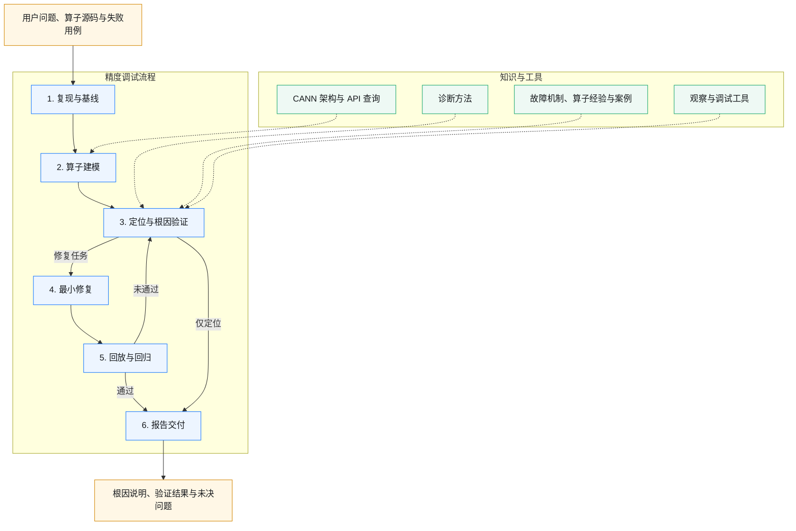

# Ascend C 精度调试 Skill

`tool-precision-debug` 用于定位 Ascend C 算子的精度异常，引导 Agent 从复现问题、分析计算链到验证根因、实施修复和完成回归。适用于精度验证失败、输出全零或随机、NaN/Inf、低精度误差超预期，以及 Cast、DataCopy、归约或同步相关的数值异常。

## 工作流与架构图



| 阶段 | 主要工作 |
| --- | --- |
| 复现与基线 | 复现失败，确认输入、参考结果和精度判据 |
| 算子建模 | 理解数学语义与实际计算链，识别舍入、类型转换、索引及同步等敏感点 |
| 定位与根因验证 | 结合经验提出候选，通过观察和区分实验缩小范围、确认原因 |
| 最小修复 | 根据根因修改实现，清理临时调试改动 |
| 回放与回归 | 重跑原失败用例，检查受影响路径和关键边界 |
| 报告交付 | 汇总根因、修改内容、验证结果及尚未解决的问题 |

仅要求定位时，确认结论后直接交付报告。完整流程见 [SKILL.md](skills/tool-precision-debug/SKILL.md)。

## 知识与工具

| 能力 | 内容 |
| --- | --- |
| 诊断方法 | 错误分布分析、观察点设计、语义二分、逐层误差分析、数值对照与设备探针 |
| 经验知识 | 可复用的故障机制、算子族精度风险和历史诊断案例，按知识目录与 Markdown 链接查阅 |
| CANN 知识查询 | `knowledge-query` 查询架构、示例和类似算子；`ascendc-api-knowledge-query` 查询 Ascend C API；`runtime-api-knowledge-query` 查询 Host 侧 CANN Runtime API |
| 调试工具指引 | DumpTensor、show_kernel_debug_data、msobjdump、msSanitizer 等工具的选用与操作方法 |

## 使用指南

### 安装

安装内容包括纯净版 `tool-precision-debug`（仅 `SKILL.md`、`references/`、`evals/`，不含本 `README.md` 与 `install.sh`）以及 `cannbot-knowledge` 的 3 个查询 Skill（`knowledge-query`、`ascendc-api-knowledge-query`、`runtime-api-knowledge-query`）。

- **交互式引导安装（推荐）**：直接运行下方命令，脚本会在终端依次引导你选择**目标客户端**（`codex`、`gemini`、`opencode`、`claude`）与**安装位置**（当前项目 / 全局 / 自定义目录），默认使用全局共享的 `~/.cannbot/cannbot-knowledge` 并在确认摘要中明确提示：

```bash
curl -fsSL https://raw.gitcode.com/cann/asc-tools/raw/master/skills/tool-precision-debug/scripts/install.sh | bash
```

- **非交互直装（通过参数跳过提示）**：`codex`、`gemini`、`opencode` 共用 `.agents/skills/`；`claude` 单独使用 `.claude/skills/`，与前者同选时自动建立软链共享：

```bash
# 默认装入当前项目 ./.agents/skills/（跳过提示）
curl -fsSL https://raw.gitcode.com/cann/asc-tools/raw/master/skills/tool-precision-debug/scripts/install.sh | bash -s -- --yes

# 仅安装到 Claude Code（直装 ./.claude/skills/，不建 .agents/skills/）
curl -fsSL https://raw.gitcode.com/cann/asc-tools/raw/master/skills/tool-precision-debug/scripts/install.sh | bash -s -- --clients claude

# 同时适配全部 4 个客户端（codex / gemini / opencode / claude）
curl -fsSL https://raw.gitcode.com/cann/asc-tools/raw/master/skills/tool-precision-debug/scripts/install.sh | bash -s -- --clients all
```

- **安装到其他项目目录或自定义目录**：

```bash
# 指定目标项目目录
curl -fsSL https://raw.gitcode.com/cann/asc-tools/raw/master/skills/tool-precision-debug/scripts/install.sh | bash -s -- --project /path/to/project

# 安装到自定义目录
curl -fsSL https://raw.gitcode.com/cann/asc-tools/raw/master/skills/tool-precision-debug/scripts/install.sh | bash -s -- --target /path/to/my-skills
```

本地已有文件时，在本 README 所在目录执行：

```bash
bash scripts/install.sh
```

### 全局安装

需要在当前用户的所有项目中使用时，添加 `--global`：

```bash
# 全局安装到 ~/.agents/skills/（支持 Codex、Gemini CLI、OpenCode）
curl -fsSL https://raw.gitcode.com/cann/asc-tools/raw/master/skills/tool-precision-debug/scripts/install.sh | bash -s -- --global

# 全局安装并同时适配 Claude Code（~/.agents/skills/ + ~/.claude/skills/ 软链）
curl -fsSL https://raw.gitcode.com/cann/asc-tools/raw/master/skills/tool-precision-debug/scripts/install.sh | bash -s -- --global --clients all

# 仅全局安装到 Claude Code（~/.claude/skills/）
curl -fsSL https://raw.gitcode.com/cann/asc-tools/raw/master/skills/tool-precision-debug/scripts/install.sh | bash -s -- --global --clients claude
```

| 客户端 | 项目级目录 | 全局目录 |
| --- | --- | --- |
| Codex / Gemini CLI / OpenCode | `./.agents/skills/` | `~/.agents/skills/` |
| Claude Code | `./.claude/skills/` | `~/.claude/skills/`（支持 `CLAUDE_CONFIG_DIR`） |

### 安装选项与检查

| 常用选项 | 用途 |
| --- | --- |
| `--clients <list\|all>` | 指定目标客户端：`codex,gemini,opencode,claude` 或 `all`（默认 `codex,gemini,opencode`） |
| `--project <dir>` | 指定项目目录（默认当前目录） |
| `--global` | 为当前用户全局安装，与 `--project`、`--target` 互斥 |
| `--target <dir>` | 直接安装到自定义目录 |
| `--python <bin>` | 指定 Python >= 3.10 解释器（默认自动探测或读取 `CANNBOT_PYTHON`） |
| `--knowledge-root <dir>` | 复用已有本地完整 `cannbot-knowledge` 仓库（默认 `~/.cannbot/cannbot-knowledge`） |
| `--without-knowledge` | 仅安装 `tool-precision-debug`，不准备知识库与查询 Skill |
| `--offline` | 离线模式：仅复用已有本地文件与 Python 依赖，不联网更新 |
| `--force` | 覆盖目标目录中已存在但非本 Skill 的同名目录 |
| `-y, --yes` | 非交互模式：直接按默认值安装，不弹出选择提示 |

这些选项同样支持 `curl ... | bash -s --` 命令。完整参数见 `bash scripts/install.sh --help`。

> **关于更新与 `cannbot-knowledge` 共享目录**：
> - **安装与更新使用同一条命令**：后续 `tool-precision-debug` 或 `cannbot-knowledge` 有新版本时，直接重跑安装命令（不加 `--offline`）即可自动拉取最新 Skill、fast-forward 更新共享知识仓，并在卡片变化时自动重建检索索引（耗时步骤自带动态进度与计时提示）。
> - 知识仓默认存放于全局共享目录 **`~/.cannbot/cannbot-knowledge`**，多项目通过软链共用同一份知识库与索引；任一项目触发更新后，本机所有项目共享的知识库同步生效。如需按项目隔离或复用本地已有知识仓，可通过 `--knowledge-root` 指定。

安装或更新后，在目标项目中重新打开客户端，确认可以使用 `tool-precision-debug`。需要确认知识查询是否可用时，可以让 Agent 执行：

```text
使用 ascendc-api-knowledge-query，查询当前目标平台上 DataCopyPad 的使用约束，并给出依据。
```

### 触发方式

可以直接点名 Skill，也可以描述需要排查的精度问题，例如：

```text
使用 tool-precision-debug，定位这个算子的精度失败。
这个 Ascend C 算子的输出偶尔全零，请帮助定位原因。
这个归约算子的误差超出项目阈值，请检查计算链和中间精度。
```

### 调试前提供什么

- 算子源码，以及构建、运行和测试入口。
- 失败输入或可复现步骤，相关 shape、dtype 和属性。
- 参考结果或 reference 实现，以及项目的精度判据。
- 实际使用的设备、CANN 版本和已有错误输出。
- 本次目标：只定位原因，还是允许修改并验证。

### 使用示例

定位并修复：

```text
使用 tool-precision-debug 排查当前算子的精度问题。
先按项目现有测试复现，确认根因后进行最小修复，
最后回放失败用例并完成相关回归，给出实际测试结果。
```

只定位，不修改正式实现：

```text
使用 tool-precision-debug 定位这个算子的输出异常。
可以做必要的观察和区分实验，暂不修改正式实现。
请说明问题位置、触发条件、证据和仍未确认的部分。
```

复核已有修复：

```text
检查当前精度修复是否完整。
按原输入和比较器回放失败，核对受影响路径及关键边界，
说明哪些结果已经验证、还有哪些缺口。
```

### 结果交付

根据任务目标，Agent 会交付根因分析、相关代码位置、修复说明和测试结果；无法确认的原因或尚未完成的验证会单独列出。需要保存报告时，可以在任务中指定输出目录。
