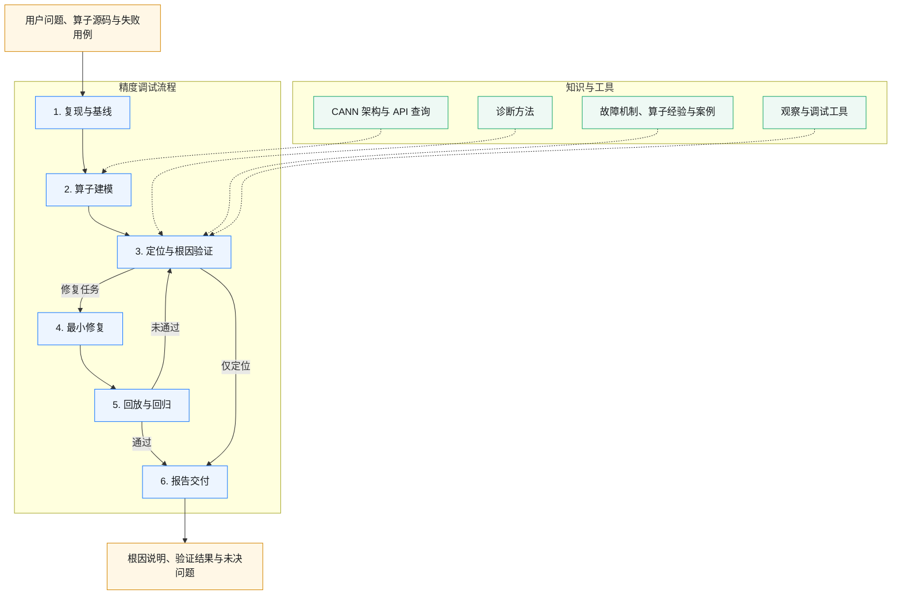

# Ascend C 精度调试 Skill

`tool-precision-debug` 用于定位 Ascend C 算子的精度异常，引导 Agent 从复现问题、分析计算链到验证根因、实施修复和完成回归。适用于精度验证失败、输出全零或随机、NaN/Inf、低精度误差超预期，以及 Cast、DataCopy、归约或同步相关的数值异常。

## 工作流与架构图



| 阶段 | 主要工作 |
| --- | --- |
| 复现与基线 | 复现失败，确认输入、参考结果和精度判据 |
| 算子建模 | 理解数学语义与实际计算链，识别舍入、类型转换、索引及同步等敏感点 |
| 定位与根因验证 | 结合经验提出候选，通过观察和区分实验缩小范围、确认原因 |
| 最小修复 | 根据根因修改实现，清理临时调试改动 |
| 回放与回归 | 重跑原失败用例，检查受影响路径和关键边界 |
| 报告交付 | 汇总根因、修改内容、验证结果及尚未解决的问题 |

仅要求定位时，确认结论后直接交付报告。完整流程见 [SKILL.md](skills/tool-precision-debug/SKILL.md)。

## 知识与工具

| 能力 | 内容 |
| --- | --- |
| 诊断方法 | 错误分布分析、观察点设计、语义二分、逐层误差分析、数值对照与设备探针 |
| 经验知识 | 可复用的故障机制、算子族精度风险和历史诊断案例，按知识目录与 Markdown 链接查阅 |
| CANN 知识查询 | `knowledge-query` 查询架构、示例和类似算子；`ascendc-api-knowledge-query` 查询 Ascend C API |
| 调试工具指引 | DumpTensor、show_kernel_debug_data、msobjdump、msSanitizer 等工具的选用与操作方法 |

## 使用指南

### 安装

安装内容包括 `tool-precision-debug`、`knowledge-query` 和 `ascendc-api-knowledge-query`。默认安装到当前目录 `.`，以下命令可直接复制执行。需要更改安装目录时，将 `.` 改为已有项目的路径，例如 `/path/to/project`。省略目录参数时也使用当前目录。

安装到 Codex：

```bash
curl -fsSL https://raw.gitcode.com/cann/asc-tools/raw/master/skills/tool-precision-debug/scripts/install.sh | bash -s -- codex .
```

安装到 Claude Code：

```bash
curl -fsSL https://raw.gitcode.com/cann/asc-tools/raw/master/skills/tool-precision-debug/scripts/install.sh | bash -s -- claude .
```

安装到 OpenCode：

```bash
curl -fsSL https://raw.gitcode.com/cann/asc-tools/raw/master/skills/tool-precision-debug/scripts/install.sh | bash -s -- opencode .
```

本地已有文件时，在本 README 所在目录执行：

```bash
bash scripts/install.sh codex .
```

### 全局安装

需要在当前用户的所有项目中使用时，显式添加 `--global`。

Codex：

```bash
curl -fsSL https://raw.gitcode.com/cann/asc-tools/raw/master/skills/tool-precision-debug/scripts/install.sh | bash -s -- codex --global
```

Claude Code：

```bash
curl -fsSL https://raw.gitcode.com/cann/asc-tools/raw/master/skills/tool-precision-debug/scripts/install.sh | bash -s -- claude --global
```

OpenCode：

```bash
curl -fsSL https://raw.gitcode.com/cann/asc-tools/raw/master/skills/tool-precision-debug/scripts/install.sh | bash -s -- opencode --global
```

| 客户端 | 默认全局 Skill 入口 |
| --- | --- |
| [Codex](https://learn.chatgpt.com/docs/build-skills) | `~/.agents/skills/` |
| [Claude Code](https://code.claude.com/docs/en/skills) | `~/.claude/skills/` |
| [OpenCode](https://opencode.ai/docs/skills/) | `~/.config/opencode/skills/` |

已有 `CLAUDE_CONFIG_DIR`、`OPENCODE_CONFIG_DIR` 或 `XDG_CONFIG_HOME` 设置时，安装器使用对应配置目录。全局安装的精度 Skill 实体位于 `~/.asc-tools/tool-precision-debug/`，知识库默认位于 `~/.cannbot/cannbot-knowledge/`，只为所选客户端建立入口。查询时按当前任务指定目标平台。

### 安装选项与检查

| 常用选项 | 用途 |
| --- | --- |
| `--global` | 为当前用户全局安装，与项目目录参数互斥 |
| `--python` | 后接 Python 可执行文件，指定安装时使用的环境 |
| `--knowledge-root` | 后接已有完整知识库的目录，直接复用 |
| `--offline` | 使用已准备好的本地文件和依赖安装 |
| `--update` | 更新通过在线安装获取的内容 |

这些选项同样支持 curl 安装命令。更多选项见 `bash scripts/install.sh --help`。

默认的项目安装将精度调试 Skill 放在 `.asc-tools/tool-precision-debug/`，其中直接包含 `SKILL.md`、`references/` 和 `evals/`，知识库下载到 `.cannbot/cannbot-knowledge/`，知识配置保存在 `.cannbot/knowledge.env`。Codex 和 OpenCode 共用 `.agents/skills/` 入口，OpenCode 不再额外创建 `.opencode/skills/`；Claude Code 另建 `.claude/skills/` 链接。OpenCode 项目重装会清理指向同一份已安装 Skill 的旧链接，保留其他内容；复用的知识仓不会自动搬迁。

安装或更新后，在目标项目中重新打开客户端，确认可以使用 `tool-precision-debug`。需要确认知识查询是否可用时，可以让 Agent 执行：

```text
使用 ascendc-api-knowledge-query，查询当前目标平台上 DataCopyPad 的使用约束，并给出依据。
```

### 触发方式

可以直接点名 Skill，也可以描述需要排查的精度问题，例如：

```text
使用 tool-precision-debug，定位这个算子的精度失败。
这个 Ascend C 算子的输出偶尔全零，请帮助定位原因。
这个归约算子的误差超出项目阈值，请检查计算链和中间精度。
```

### 调试前提供什么

- 算子源码，以及构建、运行和测试入口。
- 失败输入或可复现步骤，相关 shape、dtype 和属性。
- 参考结果或 reference 实现，以及项目的精度判据。
- 实际使用的设备、CANN 版本和已有错误输出。
- 本次目标：只定位原因，还是允许修改并验证。

### 使用示例

定位并修复：

```text
使用 tool-precision-debug 排查当前算子的精度问题。
先按项目现有测试复现，确认根因后进行最小修复，
最后回放失败用例并完成相关回归，给出实际测试结果。
```

只定位，不修改正式实现：

```text
使用 tool-precision-debug 定位这个算子的输出异常。
可以做必要的观察和区分实验，暂不修改正式实现。
请说明问题位置、触发条件、证据和仍未确认的部分。
```

复核已有修复：

```text
检查当前精度修复是否完整。
按原输入和比较器回放失败，核对受影响路径及关键边界，
说明哪些结果已经验证、还有哪些缺口。
```

### 结果交付

根据任务目标，Agent 会交付根因分析、相关代码位置、修复说明和测试结果；无法确认的原因或尚未完成的验证会单独列出。需要保存报告时，可以在任务中指定输出目录。
